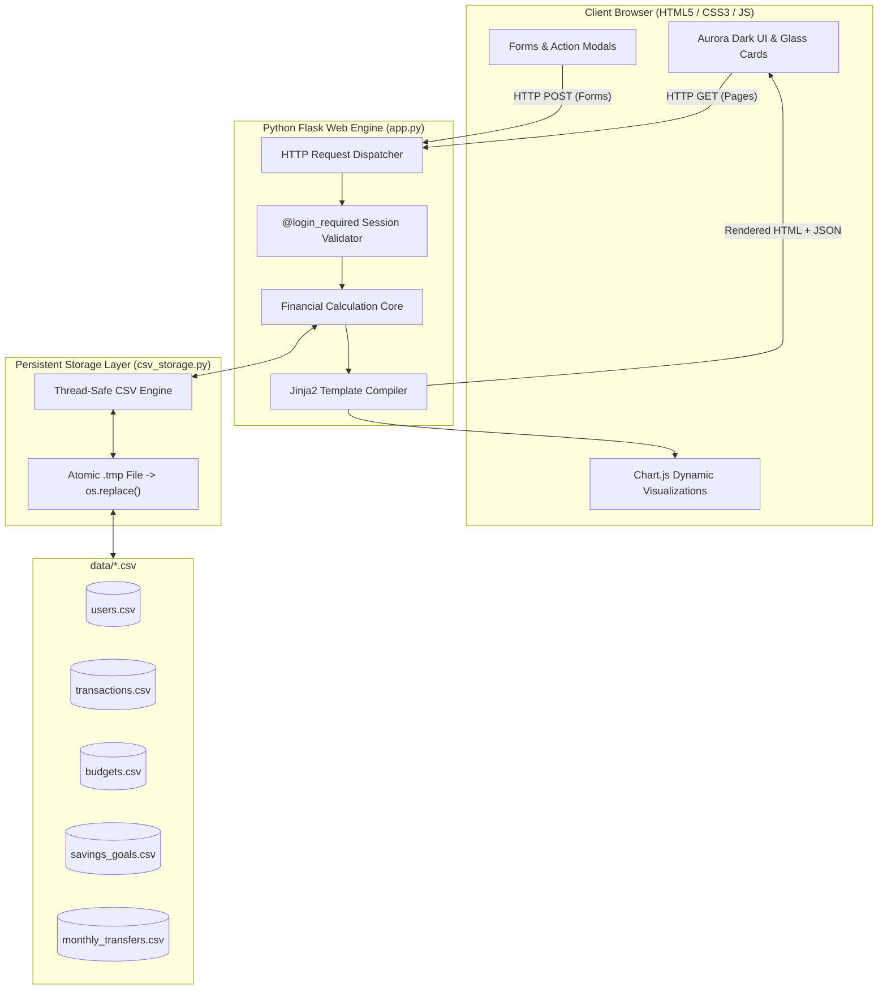

# 💎 Aurora Finance Tracker — Web Application

> A professional full-stack Personal Finance Intelligence platform built with **Python**, **Flask**, **HTML5/CSS3/JavaScript**, **Chart.js**, and persistent **CSV file storage**. Designed with the premium **Aurora Dark** glassmorphism aesthetic.

---

## 📋 Table of Contents
1. [Project Overview](#-project-overview)
2. [Design Theme — Aurora Dark](#-design-theme--aurora-dark)
3. [Architecture & Data Flow](#-architecture--data-flow)
4. [File & Directory Structure](#-file--directory-structure)
5. [Core Financial Calculation Standards](#-core-financial-calculation-standards)
6. [Prerequisites & Installation](#-prerequisites--installation)
7. [Running the Application](#-running-the-application)
8. [VS Code Setup Guide](#-vs-code-setup-guide)
9. [Pre-Seeded Demo Account](#-pre-seeded-demo-account)
10. [College Project Presentation Guide](#-college-project-presentation-guide)
11. [Technical Interview Questions & Answers](#-technical-interview-questions--answers)

---

## 🌟 Project Overview

The **Aurora Finance Tracker** enables individuals to take complete control of their personal finances. Unlike typical database-heavy applications, this system uses an **atomic CSV storage engine** built with Python's standard library. It requires zero database servers (no MySQL, PostgreSQL, or MongoDB) while ensuring full ACID-like atomic writes, session security, and data persistence across server reboots.

### Key Capabilities:
* **Real Authentication:** User signup & login with SHA-256 password hashing.
* **Liquid Solvency Tracking:** Live calculation of available balance, total income, total expenses, and locked savings.
* **Interactive Analytics:** 8 dynamic Chart.js charts (Line, Doughnut, Horizontal Bar, Stacked Bar, Grouped Cash Flow).
* **Category Budgets:** Dynamic progress bars that switch colors (Teal $\to$ Amber $\to$ Crimson) when spending exceeds 75% and 100%.
* **Savings Milestone Engine:** Dedicated deposit and withdrawal workflows with anti-double-counting guarantees.
* **Audit Trail & Filtering:** Real-time transaction search, category filters, and monthly financial breakdowns.

---

## 🎨 Design Theme — Aurora Dark

The user interface uses a bespoke glassmorphic dark palette inspired by high-end financial analytics dashboards:

| Element | Color Code | Role / Meaning |
|---|---|---|
| **Page Background** | `#0B1020` | Deep midnight blue background |
| **Sidebar / Drawer** | `#10172A` | Elevated dark navy navigation bar |
| **Cards & Panels** | `#17213B` | Floating glassmorphism surface |
| **Primary Accent (Teal)** | `#14B8A6` | Primary action buttons, badges, links |
| **Secondary Accent (Purple)**| `#8B5CF6` | Highlights, charts, and brand gradient |
| **Blue Accent** | `#60A5FA` | Liquid balance, neutral data points |
| **Income Indicator** | `#10B981` | Positive cash flow & green badges |
| **Expense Indicator** | `#F87171` | Outflow spending, over-budget alerts |
| **Savings Indicator** | `#2DD4BF` | Earmarked savings milestone badges |
| **Primary Text** | `#F8FAFC` | High-contrast readable typography |
| **Secondary Text** | `#94A3B8` | Subtitles, labels, and muted timestamps |

---

## 🏗️ Architecture & Data Flow



---

## 📁 File & Directory Structure

```text
finance_web/
│
├── app.py                         # Main Flask application & routes (800+ lines)
├── csv_storage.py                 # Persistent CSV storage engine & CRUD methods
├── requirements.txt               # Project dependencies (Flask, Werkzeug, Jinja2)
├── README.md                      # Complete project documentation & guide
│
├── data/                          # Auto-generated CSV files (Persistent database)
│   ├── users.csv                  # Credentials & registration profiles
│   ├── transactions.csv           # Income and expense records
│   ├── budgets.csv                # Category monthly spending limits
│   ├── savings_goals.csv          # Milestone targets and saved balances
│   └── monthly_transfers.csv      # Audit trail for savings transfers
│
├── static/
│   ├── css/
│   │   └── style.css              # 1,000+ lines Aurora Dark CSS design system
│   └── js/
│       └── main.js                # Chart.js initialization, toasts, filters, modals
│
└── templates/
    ├── base.html                  # Master Jinja2 template with responsive sidebar
    ├── login.html                 # Login page with animated background orbs
    ├── register.html              # Account registration with live validation
    ├── dashboard.html             # Main analytics dashboard & stat cards
    ├── income.html                # Income manager, bar chart, and source doughnut
    ├── expense.html               # Expense tracker, trend chart, and category doughnut
    ├── budget.html                # Budget planner, dynamic progress bars & tips
    ├── savings.html               # Savings milestone cards, deposit & withdraw modals
    ├── transactions.html          # Transaction audit table with search & filter
    ├── reports.html               # Annual performance, cash flow bar, & monthly table
    ├── 404.html                   # Custom 404 page in Aurora Dark theme
    └── 500.html                   # Custom 500 server error page
```

---

## 🧮 Core Financial Calculation Standards

The application guarantees four mathematical principles:

### 1. The Liquid Solvency Equation
$$\mathbf{Available\ Balance} = \mathbf{Total\ Income} - \mathbf{Total\ Expenses} - \mathbf{Net\ Savings\ Contributions}$$

### 2. Savings Transfer Isolation Rule
Depositing money into a savings goal:
* Increases `saved` in `savings_goals.csv`.
* Logs an entry in `monthly_transfers.csv`.
* **Never adds an expense record to `transactions.csv`.** Total Expenses remains true to everyday spending.

### 3. Savings Withdrawal Rule
Withdrawing funds from a goal back to liquid cash:
* Reduces `saved` in `savings_goals.csv`.
* Logs a negative transfer in `monthly_transfers.csv`.
* **Never counts as income in `transactions.csv`.** Total Income is not artificially inflated.

### 4. Zero Double-Counting Guarantee
Because savings transfers and liquid expenses operate in separate, mathematically isolated ledgers, no money is counted more than once.

---

## 💻 Prerequisites & Installation

### Prerequisites:
* Python 3.9 or higher (tested on Python 3.10, 3.11, 3.12, 3.13, 3.15).
* Web browser (Google Chrome, Edge, Firefox, or Safari).

### Installation:
1. Clone or copy the project folder to your machine:
   ```powershell
   cd "C:\Users\RAJA SEKHAR\.gemini\antigravity\scratch\finance_web"
   ```

2. Install the required Python packages using `pip`:
   ```powershell
   pip install -r requirements.txt
   ```

---

## ▶️ Running the Application

1. Open PowerShell or Command Prompt and run:
   ```powershell
   python app.py
   ```

2. You will see the terminal output:
   ```text
   =================================================================
     Aurora Finance Tracker — Phase 4 Full-Stack Integration
     Connected to CSV Storage in: data/*.csv
     Application running at: http://127.0.0.1:5000
     Press Ctrl+C to terminate server
   =================================================================
    * Serving Flask app 'app'
    * Debug mode: on
    * Running on http://127.0.0.1:5000
   ```

3. Open your browser and navigate to:
   ```
   http://127.0.0.1:5000
   ```

---

## 🛠️ VS Code Setup Guide

1. Open **Visual Studio Code**.
2. Click **File** $\to$ **Open Folder...** $\to$ Select `finance_web`.
3. Open `app.py`.
4. If prompted to select a Python interpreter, choose your installed Python version.
5. Press <kbd>Ctrl</kbd> + <kbd>`</kbd> to open the built-in terminal.
6. Type `python app.py` and press <kbd>Enter</kbd>.
7. Click the `http://127.0.0.1:5000` link in the terminal while holding <kbd>Ctrl</kbd> to launch in your browser.

---

## 🔑 Pre-Seeded Demo Account

The application automatically sets up starter data so you can test it immediately:
* **Username:** `rajasekhar`
* **Password:** `password123`

*(You can also click "Create one free" on the login page to register any number of new users with separate accounts).*

---

## 🎓 College Project Presentation Guide

### 1. Project Title
> **Aurora Personal Finance Tracker:** A Glassmorphic Full-Stack Web Application for Personal Financial Intelligence Using Python Flask and Atomic CSV Persistence.

### 2. Problem Statement
Many individuals struggle to track their cash flow, overspend across categories, and fail to meet savings milestones due to complex or paid financial software. Traditional web applications also frequently require heavy database engines (MySQL, PostgreSQL, Oracle) that are difficult to deploy and maintain on lightweight or offline systems.

### 3. Proposed Solution
A lightweight, secure, and beautiful financial dashboard built with Python Flask and vanilla front-end technologies. The solution utilizes an atomic CSV storage architecture that guarantees data persistence and reliability while providing professional analytics through Chart.js and an Aurora Dark user experience.

### 4. Technical Novelty & Key Highlights
* **Zero Database Overhead:** Runs anywhere Python is installed using built-in CSV manipulation.
* **ACID-like Atomic Writes:** Employs temporary file staging (`.tmp`) and `os.replace()` to prevent file corruption during power outages.
* **Mathematical Integrity:** Implements clean separation between operational expenses and savings milestone deposits, preventing double-counting errors common in consumer finance apps.
* **Responsive Glassmorphism:** CSS modern glass UI with responsive side drawer, animated progress bars, and modal forms.

---

## 💼 Technical Interview Questions & Answers

### Q1: Why did you choose CSV files over an SQL database like SQLite or MySQL?
> **Answer:** For a desktop-grade, lightweight personal finance application, Python's built-in `csv` module eliminates the need for database drivers, server configurations, or external connection strings. It allows human-readable inspection, effortless backups, and instant cross-platform portability. To ensure reliability, we implemented an atomic write pattern using temporary files and OS-level renaming to prevent file corruption.

### Q2: How does the application prevent double-counting when transferring money to savings?
> **Answer:** A common flaw in basic finance apps is treating savings contributions as standard expenses. In our system, the formula is:
> $$\text{Available Balance} = \text{Total Income} - \text{Total Expenses} - \text{Net Savings}$$
> Savings transfers are stored in `monthly_transfers.csv` and tracked in `savings_goals.csv`. They are strictly excluded from `transactions.csv` expense rows. This ensures Total Expenses reflects only actual lifestyle spending, while Available Balance correctly reflects the remaining liquid funds.

### Q3: How do you handle password security in this project?
> **Answer:** Passwords are never stored in plaintext. When a user registers or logs in, the password is processed using SHA-256 cryptographic hashing (`hashlib.sha256()`). Only the 64-character hexadecimal digest is stored in `data/users.csv`. During authentication, the entered password is hashed and compared against the stored hash.

### Q4: How is session management implemented?
> **Answer:** We use Flask's signed cookie sessions. When credentials match, `session['username']` and `session['full_name']` are initialized. A custom Python decorator (`@login_required`) guards all analytical routes. If a user tries to access `/dashboard` without an active session, they are redirected to `/login` with an informational toast.

### Q5: What happens if two transactions are written simultaneously?
> **Answer:** In our `csv_storage.py` engine, append operations utilize Python's standard file append mode (`mode="a"`), which maps to the operating system's `O_APPEND` flag. In addition, atomic updates write to a `.tmp` file before calling `os.replace()`, guaranteeing that partially written data never corrupts the master ledger.
